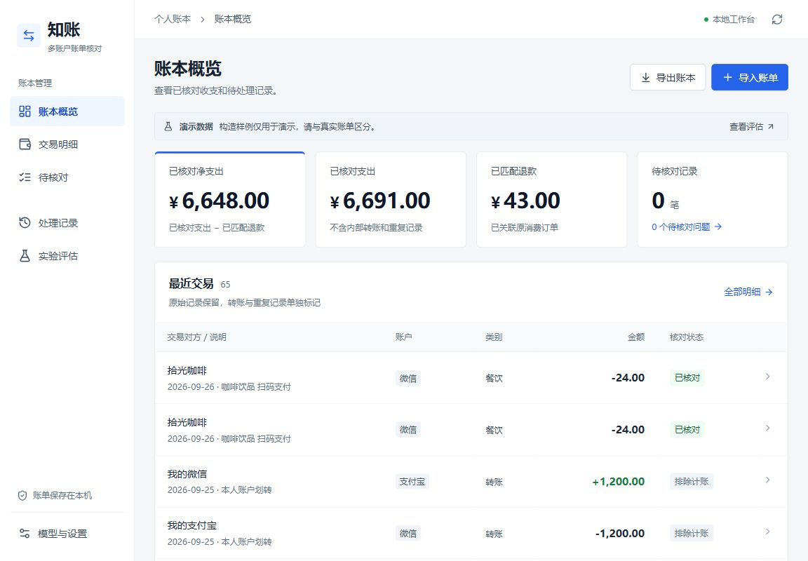
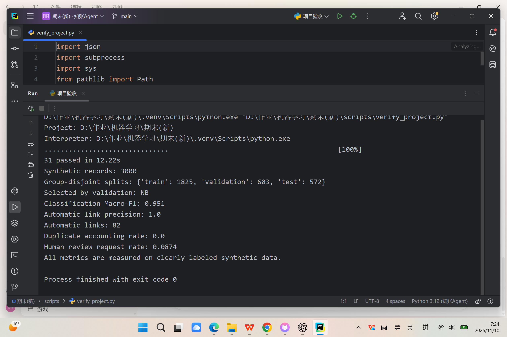

# 知账 · 个人多账户账单整理与异常核对 Agent

把微信、支付宝账单汇在一起，厘清消费、转账、退款和重复记录。系统发现不确定项后暂停，请用户核对，再更新账本并保留修改记录。

> 公开样例全部为**明确标注的构造账单**，不是用户真实支付记录。构造数据指标不能代表真实账单效果。



## 快速运行 Windows

需要 Python 3.12、Node.js 22 或更新版本。推荐在 PyCharm 中打开本目录，解释器选择 `.venv/Scripts/python.exe`。

```powershell
python -m venv .venv
.\.venv\Scripts\python.exe -m pip install -r requirements-lock.txt
.\.venv\Scripts\python.exe scripts/generate_data.py
.\.venv\Scripts\python.exe scripts/make_demo.py
.\.venv\Scripts\python.exe scripts/train.py
cd frontend
npm ci
npm run build
cd ..
.\.venv\Scripts\python.exe run.py
```

浏览器访问 **http://127.0.0.1:8000**，点击“导入账单”，再选择“没有账单？先用构造数据体验”。也可执行 `./start.ps1` 完成依赖检查、训练、前端构建与启动。首次安装需联网下载依赖；OCR 默认模型由 RapidOCR 发行包提供或首次使用时下载。

开发时可分别运行 `python run.py` 和前端 `npm run dev`；生产构建由同一个 FastAPI 服务提供，无需独立部署前端。

## 演示流程

1. 载入65条构造账单，查看微信与支付宝记录、本人账户划转、部分退款、关闭订单和重复副本。
2. 进入“待核对”，确认朋友转账是对外付款；给不明确商户选择消费类别。
3. 对原订单缺失的退款补充账单或排除此条；确认同额近时的咖啡交易是否重复；核对异常大额消费。
4. 在明细中查看原始字段、来源文件与行号；在“处理记录”查看轨迹，撤销一次修正再重新确认。
5. 导出 XLSX，检查核对后账本、待核对记录、排除记录、全部记录与修改记录五张表。

详细过程见 [演示说明](docs/DEMO.md)，架构与接口见 [系统设计](docs/ARCHITECTURE.md)，实验见 [评估说明](docs/EVALUATION.md)。

当前交付进度与尚需用户配置的验收事项见 [交付状态](docs/DELIVERY_STATUS.md)。



## 输入与账务口径

- 文件：微信、支付宝 CSV/XLSX；支持UTF-8、GB18030及账单说明行。未知表头可手工映射。
- 文字：例如 `2026-09-08 12:30 青禾面馆 支出 28.00元`，也可粘贴CSV文本。没有完整日期、方向、商户或金额时要求补充。
- 截图：PNG/JPG，先本地OCR、再结构化；图中文字必须包含可确认的日期与金额，识别结果需人工复核。复杂详情页和缺年份列表不保证自动解析。
- 同批文件使用同一平台与本人账户别名；不同平台分别导入。演示按钮可一次载入双平台数据。
- 金额使用整数分；月度净支出=当月已核对支出−当月已匹配退款。退款按实际到账月份冲减，继承原消费类别。
- 同账户同订单且金额方向一致的记录排除重复计账，保留来源；本人账户转账须有双边证据或用户确认；转给朋友的付款不自动排除。
- 未核对记录不进入已核对汇总；汇总金额在核对完成前不是最终月支出。

## 大模型配置

复制 `.env.example` 为 `.env`，只在本机填写 `LLM_API_KEY`，不要在聊天、报告或GitHub中粘贴密钥。默认Qwen-Flash，服务地址和模型名均可调整。

点击网页右上角刷新，展开概览底部的“账单助手”，勾选“允许发送本次问题与脱敏汇总至API”。对话仅发送用户本次问题、汇总数字和匿名核对问题；不自动发送原始图片、商户、订单号或账户名。用户主动输入的问题可能含个人信息，请自行检查。

本次已实际验证用户配置的qwen3.7-flash，接入过程、思考模式超时修复、tokens与费用记录见 [真实接口验证](docs/API_VALIDATION.md)。默认关闭思考；更换其他兼容模型时可调整或移除LLM_ENABLE_THINKING配置。更换平台或模型后须按相应计费页更新单价，单价留空时不会调用API。

预算默认5元，以配置单价及tokens估算，调用前预留费用，失败请求保留估算费用；不自动充值。该限制只覆盖本项目发起的调用，不替代服务商账单或账号级消费限额。没有密钥时，本地模型与表单核对仍可运行，界面明确标注“本地”。

## 训练、实验与测试

```powershell
.\.venv\Scripts\python.exe scripts/train.py
.\.venv\Scripts\python.exe scripts/evaluate.py
.\.venv\Scripts\python.exe -m pytest -q
```

固定种子20261110。3000条构造记录，按商户组、关联事件分组，训练/验证/测试使用不同句式模板族；类目词共享。特征仅使用商户和商品说明，以及匹配时的金额、时间、方向和订单线索；`truth_*`、`split`等不进入模型。

类别模型在验证集选择，匹配阈值也只使用验证集。报告候选对级指标与工作流自动关联结果，二者不能混淆。详细指标、配置、错误样例和消融结果保存在 `results/`。

用户修正类别后，可在设置中更新模型。当前实现合并初始训练集与本地纠正标签重新训练，保留旧版本；不要把固定测试样例的真值用于更新后再宣称原始测试性能。

## 目录

```text
backend/       FastAPI接口、账务规则、LangGraph流程、模型与本地存储
frontend/      React/TypeScript界面
scripts/       数据生成、训练、评估、复现与验收
tests/         账务边界、接口、恢复、撤销和预算测试
skills/        适配后的账单数据体检技能
third_party/   上游技能原文、源码及提交号和哈希
data/          公开构造样例与数据说明
results/       实际实验结果、图表与错误样例
docs/          架构、评估、复用与演示材料
runtime/       本地账本、检查点、原始上传与调用费用（不提交）
models/        本机训练的可信模型文件（不提交）
```

## 隐私、许可与边界

真实账单须经用户授权，仅在本地验证；不要提交 `runtime/`、`data/private/`、`.env` 或私人截图。当前公开材料不含真实账单。只加载本项目自己训练的joblib模型，不能加载陌生来源的pickle/joblib文件。

自身代码采用MIT，构造数据采用CC0-1.0；第三方组件不改变原许可证。组件版本、来源和具体复用方式见 [组件清单](docs/COMPONENTS.md)。上游CSV技能README声明MIT，但没有独立LICENSE文件，已如实记录；原脚本不在本系统中直接执行。

本项目为《机器学习》个人课程项目。设计、代码和文档使用Codex辅助生成、调试及核验；全部实验来自实际运行，不将模拟人工反馈或构造样例表述为真实用户研究。
