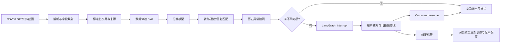

# 系统设计与接口

## 处理流程

这是围绕账单任务的有状态工作流Agent。LangGraph管理状态和中断；机器学习工具承担实际分类、匹配和异常检测；大模型承担文字结构化、核对对话和解释，不接管最终金额计算。

`backend/workflow.py`定义quality、reconcile、review、finish节点。SQLite检查点以job_id为thread_id；重启服务后仍可恢复。核对操作使用进程内锁，重复提交关闭的问题返回409；单机版本以单worker运行。

账单、问题、任务、修改事件分表保存。金额为非负整数分，方向单独表示。Transaction保留订单号、原订单引用、状态、来源与raw字段；raw不会参与类别特征。交易修正产生修改前后快照，逆序撤销并检查后续修改冲突。

## API

本地服务地址为127.0.0.1:8000。交互式接口文档为 `/docs`。

|接口|输入|输出与用途|
|---|---|---|
|GET /api/config|无|模型版本、密钥是否就绪、费用；不返回密钥|
|POST /api/import/files|multipart文件、platform、account、synthetic|任务、错误行、OCR原文或待映射列|
|POST /api/import/text|text、platform、account、synthetic|本批任务|
|POST /api/jobs/{id}/mapping/{token}|标准字段到原始列名的mapping|映射后任务|
|POST /api/jobs/{id}/run|任务ID|启动图并返回任务状态|
|GET /api/jobs/{id}|任务ID|状态、轨迹与批次汇总|
|GET /api/ledger|可选job_id、search、category、month、state|交易列表与核对后汇总|
|GET /api/reviews|可选job_id|开放核对问题|
|POST /api/reviews/{id}/answer|action及可选category、target_id|修改后交易与审计事件|
|PATCH /api/ledger/{id}|category或excluded|修改事件|
|POST /api/events/{id}/undo|事件ID|恢复快照；后续冲突返回409|
|GET /api/export|format=csv/xlsx，可选job_id|防公式注入的账本文件|
|POST /api/chat|message、allow_remote|答复、local/api标识与工具使用说明|
|POST /api/models/update|无|使用用户纠正记录重新训练后的版本|

ReviewAnswer的action只允许confirm、category、link、keep、exclude；退款关联检查先后日期、消费类型和累计金额。不同类型问题限制可执行操作。模型输出不能直接执行Python、SQL或系统命令。

## 异常与失败处置

解析失败的行连同原因保留；未知表头由用户映射。截图OCR逐项确认。类别置信度、匹配分数不足或存在候选歧义时进入核对；退款超额不会自动入账。接口超时回退本地工具并显示原因，预算耗尽停止外部请求。历史不足30条此前月份消费时不拟合历史异常模型；异常提示不作欺诈结论。

本地版本不提供支付、转账、账户登录或云端多人服务。服务只绑定127.0.0.1，不应直接暴露到公网。
