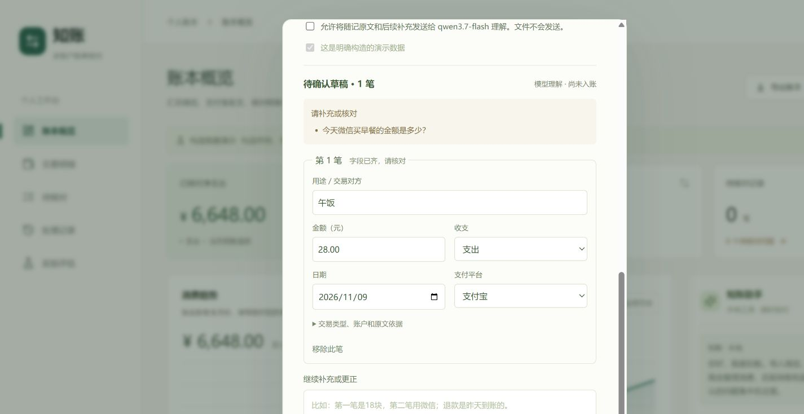
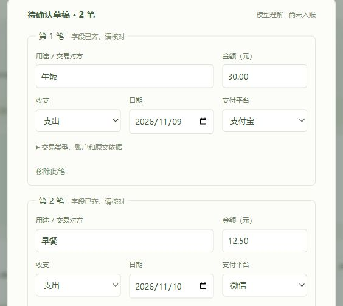

# 随手记账与真实模型验证

导入窗口保留文件导入，文字部分改为随记。用户可写日常语言，例如“昨天午饭花了二十八，今天支付宝打车十五块”，不用先整理日期、收支等标准字段。

1. 选择默认平台、本人账户与记账日期。未提日期的交易使用所选日期；相对日期也以此为基准。
2. 勾选允许发送随记原文，点击“理解并生成草稿”。该许可独立于右侧助手；原始文件不会随之发送。没有配置或没有许可时，仅本地解析和手工填写。
3. 检查拆分出的每笔用途、金额、收支、日期与平台。可继续口语补充、更正，也可直接改字段或移除误识别的一笔。
4. 金额等必填项缺失时不能保存；模型仍有问题时默认阻止保存。用户手动解决后，可明确确认仅保存所列交易，防止漏掉未完成记录。
5. 确认后才创建账本任务，进入分类、退款与转账匹配、异常核对。草稿刷新可恢复，确认接口重复调用返回同一任务。

未说明具体时分时只承认日级精度，内部使用零点占位并在raw标记time_precision=day。未给商家时可使用明确用途，如午饭或打车，不编造商户。转给朋友不能据此认定为本人账户转账。

## 实际验证

使用配置的qwen3.7-flash，输入均为明确构造的随记，记账日期为2026-11-10：

|阶段|实际输入与结果|
|---|---|
|首次输入|“构造随记：昨天午饭花了二十八块，支付宝付的。今天微信买早餐，忘了写金额。”|
|首次结果|午饭28元、11月9日、支付宝；模型询问早餐金额，没有编造金额。本次仅返回完整的午饭记录，未返回缺金额的早餐占位记录，因此补充了未解决问题默认禁止保存的校验，并加强提示词。|
|继续补充|“早餐花了十二块五，第一笔午饭其实是三十块，仍然是支付宝付的。”|
|更新结果|午饭更正为30元，保留原草稿行ID；补出早餐12.50元、11月10日、微信；没有剩余问题。|
|独立库入账|复用真实模型草稿，确认后创建2笔、合计4250分；重复确认仍为同一任务；后续LangGraph核对完成。已有65笔演示账本保持不变。|
|网页恢复|实际编辑用途后刷新，修改值恢复；随后改回原用途。刷新后远程发送许可默认不勾选。|

两次真实调用共1551 tokens，抵扣免费额度前估算0.0005778元；实际费用以平台账单为准。输入、结果、用量和独立库校验保存在[验证数据](../results/note_validation.json)。这些有限样例不能证明所有口语均能准确理解，入账前仍须人工核对草稿。





## 复现

离线回归：

```powershell
.\.venv\Scripts\python.exe -m pytest -q
```

当前共48项测试，包含随记的授权、缺字段、金额合法性、超时回退、修订冲突、刷新数据读取、退款方向、问题未解决限制、确认幂等性和输出预算预留。前端另已实际检查草稿编辑与恢复。

在本机配置API后运行以下命令，会发出两次真实调用，使用本项目预算；实际入账检查在临时独立数据库中完成：

```powershell
.\.venv\Scripts\python.exe scripts/validate_notes.py --live
```

接口细节见[系统设计](ARCHITECTURE.md)。运行数据、浏览器草稿缓存和本地密钥均不得作为公开演示数据提交；本目录验证证据只包含已标注的构造文本。
