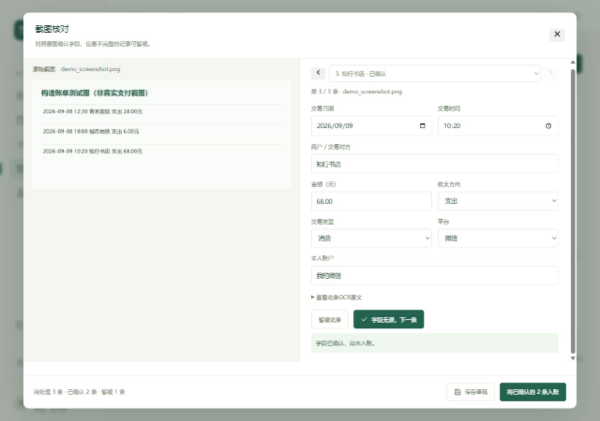

# 截图上传与字段核对

截图先在本机识别成可编辑草稿，逐条确认字段后再入账。分类、退款与重复关系仍由后续工作流检查。

## 操作

1. 点击“导入账单”，选择微信或支付宝，填写本人账户别名，上传PNG/JPG。两种平台分别导入。
2. 截图未显示年份或包含“昨天”等相对日期时，填写实际拍摄日期。不同拍摄日期分批导入。
3. 点击“识别并核对截图”。左侧为原图，右侧可修改日期、时间、商户、金额、收支方向、交易类型、平台和账户。
4. 对照原图补改字段，点击“字段无误，下一条”。缺少必要信息时点击“暂缓此条”，取得完整交易详情后继续。
5. 点击“将已确认的N条入账”。只有明确确认且字段完整的记录进入账本，重复提交不新增交易。
6. 在“待核对”处理低置信度类别、退款原单、转账和重叠候选，再导出XLSX。

点击“保存草稿”或“保存并关闭”会持久保存草稿。重新打开页面后，在“处理记录”中点击对应批次的“核对截图”继续。未提交的字段编辑另有本机浏览器缓存。入账记录保留OCR初始字段与确认字段，已入账草稿禁止再次编辑。

## 构造截图演示

使用`data/demo_screenshot.png`，包含28元餐饮、6元交通、68元书店消费。网页实测完成商户编辑、保存、刷新恢复、暂缓后再次确认、分类修正和导出：3条已核对、待核对0条、净支出102元。五张导出表行数为3、0、0、3、1。

- [浏览器验证记录](../results/screenshot_ui_verification.json)
- [实际导出账本](demo_screenshot_核对后账本.xlsx)
- [核对完成画面](screenshots/11_截图核对后账本.jpg)

视频可增加约45—60秒截图环节：上传构造图→对照原图修改字段→暂缓一条→确认其余草稿入账→恢复暂缓项→处理分类→导出。截图演示的102元独立于65条构造账单演示的6648元。

## 真实样例边界

4张经授权的微信、支付宝列表截图共标记28次可见交易出现，包含跨图重叠。自动提取的23条完整候选金额与时间对照通过；另1条金额OCR误读通过字段补改完成入账测试，剩余4条因时间截断继续暂缓。24条包含人工补改结果，不是OCR自动识别数量，也不等于24笔独立消费。

此项验证只涉及字段兼容性与核对操作，没有新增真实类别标签或真实匹配准确率。原图、逐笔字段与数据库均保存在本地私有目录，未发送外部模型API；公开仓库只保留匿名汇总。

## 接口

网页通过`POST /api/import/files`的`defer_images=true`创建草稿，旧客户端省略此参数时保留原有OCR导入与核对流程。

|接口|用途|
|---|---|
|GET /api/jobs/{id}|读取截图草稿、修订号与任务状态|
|GET /api/jobs/{id}/images/{token}|读取所属批次的本地原图，禁止缓存|
|PATCH /api/jobs/{id}/screenshots|保存字段与确认/暂缓状态，检查修订冲突|
|POST /api/jobs/{id}/screenshots/commit|校验并幂等入账，返回后续核对任务|

缺失日期与金额保留为空，未确认字段不写入账本。截图字段确认不代替类别或关联关系确认，跨图重叠候选仍需核对。
